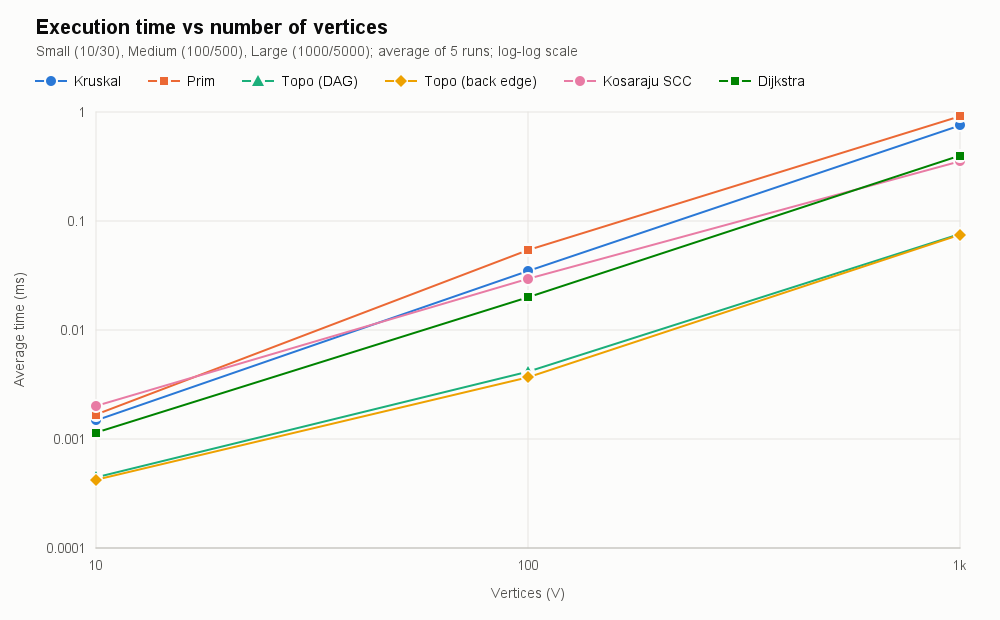
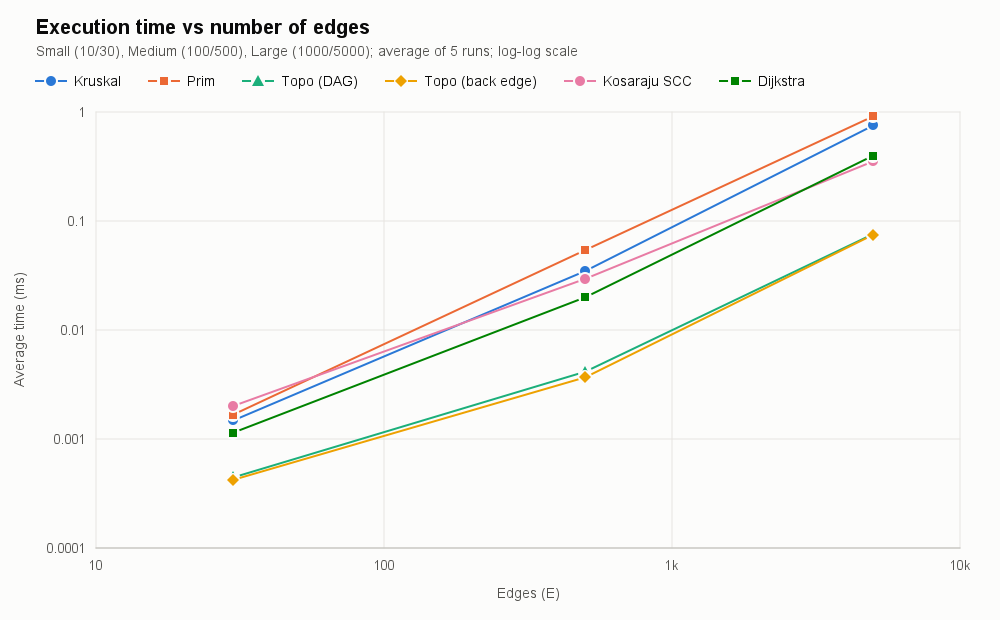
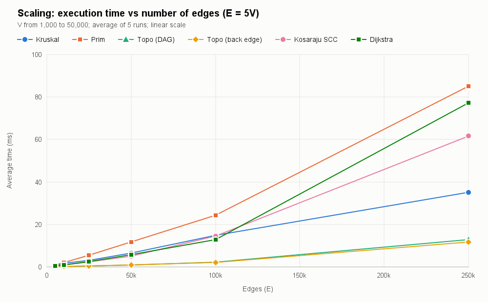
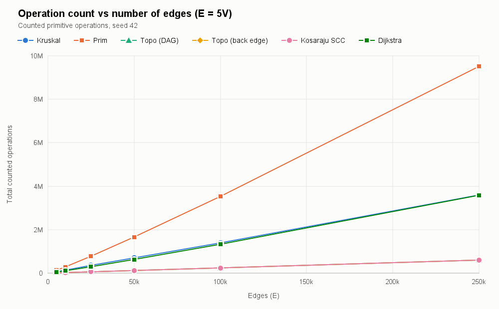
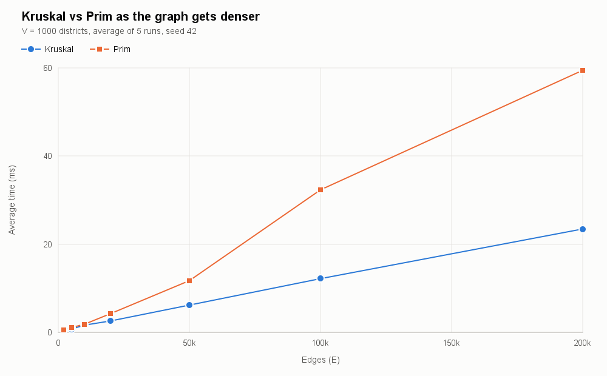
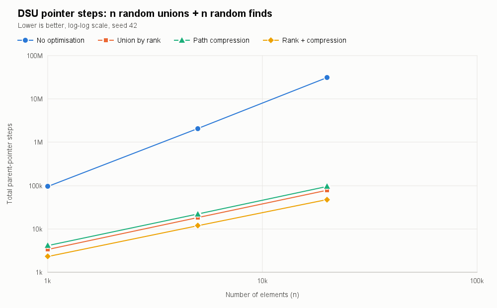

# Assignment 3 — Smart City Infrastructure and Route Planning

A Java 17 application that models a city as a graph and uses classic graph algorithms to plan infrastructure, analyse connectivity and find routes. All algorithms are implemented from scratch (no external libraries), tested for correctness and benchmarked on graphs of different sizes.

| Task | Algorithms |
|---|---|
| Infrastructure planning | Kruskal (with DSU), Prim (with priority queue) |
| Connectivity analysis | Topological ordering (Kahn), Strongly Connected Components (Kosaraju) |
| Route planning | Dijkstra (binary heap) |

## Contents

- [How to run](#how-to-run)
- [Repository structure](#repository-structure)
- [1. Overview](#1-overview)
- [2. Implementation](#2-implementation)
- [3. Complexity Analysis](#3-complexity-analysis)
- [4. Experimental Setup](#4-experimental-setup)
- [5. Results](#5-results)
- [6. Comparison and Discussion](#6-comparison-and-discussion)
- [7. Testing](#7-testing)
- [8. Conclusion](#8-conclusion)

## How to run

Requirements: JDK 17 or newer. No build tool or third-party library is needed.

**Windows**

```bat
run.bat test     :: correctness tests
run.bat demo     :: smart city demo
run.bat bench    :: all experiments, writes results/tables and results/plots
run.bat          :: everything
```

**Linux / macOS**

```bash
./run.sh test
./run.sh demo
./run.sh bench
./run.sh
```

**Manually**

```bash
javac --release 17 -d out $(find src -name "*.java")
java -cp out tests.AllTests
java -cp out app.Main
java -cp out app.Benchmark
```

The benchmark takes about 30 seconds. Every graph is generated from a fixed seed (`42`), so the graphs and all operation counts are identical on every machine; only the times depend on the hardware.

## Repository structure

```
assignment-3/
├── src/
│   ├── graph/          Edge, Graph (adjacency list), GraphGenerator, GraphUtils
│   ├── dsu/            DisjointSet (path compression + union by rank, both switchable)
│   ├── mst/            Kruskal, Prim, MSTResult
│   ├── connectivity/   TopologicalSort (Kahn), KosarajuSCC, TopoResult, SCCResult
│   ├── shortestpath/   Dijkstra, ShortestPathResult, BellmanFord (reference for tests)
│   ├── app/            Main (smart city demo), Benchmark, LineChart (PNG plots)
│   └── tests/          AllTests (71 correctness checks)
├── results/
│   ├── tables/         CSV + Markdown tables produced by Benchmark
│   ├── plots/          PNG plots produced by Benchmark
│   ├── test_output.txt
│   └── demo_output.txt
├── run.bat / run.sh
└── README.md
```

---

## 1. Overview

### The city as a graph

| City concept | Graph concept |
|---|---|
| District / location | Vertex (`0 … V-1`, each vertex can have a name such as "Central") |
| Road or infrastructure link | Edge |
| Construction cost or travel distance | Edge weight (positive integer) |
| Two-way road | Undirected edge |
| One-way road, service dependency | Directed edge |

The application answers three planning questions:

1. **Which roads should be built so that every district is connected at minimum total cost?** — Minimum Spanning Tree (Kruskal, Prim). If the city cannot be connected, both algorithms detect it and return a minimum spanning *forest*.
2. **Which districts can reach each other through one-way roads, and in what order can dependent services be built?** — Strongly Connected Components (Kosaraju) and topological ordering (Kahn), including cycle detection.
3. **What is the shortest route from a selected district to every other district?** — Dijkstra, with path reconstruction and handling of unreachable districts.

### Graph representation

The graph is stored as an **adjacency list** (`List<List<Edge>>`) plus a flat **edge list** (`List<Edge>`):

- An `Edge` object stores `from`, `to` and `weight`.
- In an **undirected** graph each edge is created once, added once to the edge list and referenced from the adjacency lists of *both* endpoints. Kruskal uses the edge list (E entries), Prim and Dijkstra use the adjacency lists (2E entries).
- In a **directed** graph the edge only appears in the adjacency list of its source.

An adjacency list uses O(V + E) memory and lets every algorithm enumerate the neighbours of a vertex in time proportional to its degree, which is what all the required algorithms need. An adjacency matrix would cost O(V²) memory (10⁶ cells already for 1,000 districts) and O(V) time per neighbour scan, which is wasteful for sparse road networks where E ≈ 5V.

### Demo

`java -cp out app.Main` runs a small named city (full output in [`results/demo_output.txt`](results/demo_output.txt)):

```
--- 1. Infrastructure planning (MST, cost in million KZT) ---
Kruskal: MST, weight=48, edges=8
Prim: MST, weight=48, edges=8
Same total weight: true
Disconnected plan: connected=false, components=2, forest weight=12

--- 2. One-way roads (strongly connected components) ---
Strongly connected components: 4
  SCC 0: [Harbor]
  SCC 1: [Central, University, Old Town]
  SCC 2: [Tech Park, Riverside]
  SCC 3: [Airport]
Condensation graph is a DAG: true, component order: [0, 1, 2, 3]

--- 3. Service dependencies (topological ordering) ---
Build order: [Power grid, Water supply, Fiber network, Traffic lights, Smart parking, Metro, City app]
After adding 'City app -> Fiber network':
Is DAG: false (topological ordering impossible, cycle detected)

--- 4. Route planning (Dijkstra, travel distance in km) ---
  Harbor       dist= 20  path=[Central, Old Town, Riverside, Harbor]
  Green Hills  dist= 24  path=[Central, Tech Park, Industrial, Green Hills]
  New Suburb   unreachable

--- 5. Why Dijkstra fails with negative weights ---
dist(A->D) Dijkstra without check = 3, Bellman-Ford = 2
```

---

## 2. Implementation

### `graph` package

- **`Graph`** — adjacency list + edge list, directed or undirected, optional vertex names. `neighbor(edge, u)` returns the other endpoint so the same code (e.g. Dijkstra) works on both kinds of graph. `reversed()` builds the transpose for Kosaraju.
- **`GraphGenerator`** — reproducible random graphs (`java.util.Random` with a fixed seed). All generated graphs are *simple*: no self-loops and no duplicate edges (a `HashSet` of edge keys rejects repeats). Weights are uniform integers in `[1, 100]`.
  - `connectedUndirected(V, E, seed)` — first builds a **random spanning tree** (vertices are shuffled; each vertex `order[i]` is linked to a random earlier vertex `order[j], j < i`), then adds random extra edges until there are exactly E. The tree guarantees the graph is connected, which the MST experiments require.
  - `randomDirected(V, E, seed)` — E random ordered pairs `(u, v)`, `u ≠ v`. With E = 3V or 5V such graphs practically always contain cycles (see section 4).
  - `randomDag(V, E, seed)` — vertices are given a random rank; an edge always goes from the lower to the higher rank, so the graph is **acyclic by construction**.
  - `dagWithBackEdge(V, E, seed)` — a DAG plus one forward edge `middle → late` and one back edge `late → middle`. It contains exactly one cycle located in the middle of the topological order, so cycle detection has to process about half of the graph first.
- **`GraphUtils`** — iterative DFS that counts connected components (independent check of connectivity).

### `dsu` package — `DisjointSet`

- Arrays `parent[]` and `rank[]`.
- `find(x)` is **iterative with two-pass path compression**: first walk up to the root, then point every node on the path directly to the root. Being iterative, it cannot overflow the call stack even on a degenerate chain of 20,000 elements.
- `union(a, b)` uses **union by rank**: the root with the smaller rank is attached under the root with the larger rank; on a tie the rank grows by one. It returns `false` if `a` and `b` were already in the same set — this is exactly the cycle test Kruskal needs.
- Both optimisations can be switched off in the constructor (`new DisjointSet(n, pathCompression, unionByRank)`), which is used to measure their effect experimentally. Counters: `find` calls, `union` calls and **pointer steps** (number of `parent` links followed).

### `mst` package

- **Kruskal** — copies the edge list, sorts it by weight (`List.sort`, a TimSort, with a counting comparator), then scans the edges and adds an edge whenever `dsu.union(u, v)` succeeds. It stops as soon as V-1 edges are chosen. The number of DSU sets left at the end is the number of connected components, so connectivity is detected for free: if it is greater than 1, the result is a minimum spanning forest.
- **Prim** — lazy version with `java.util.PriorityQueue<Edge>` (binary heap) ordered by weight. Starting from a vertex, all its edges are pushed; the cheapest edge is polled, skipped if both endpoints are already in the tree, otherwise the new vertex is added and its edges are pushed. The outer loop **restarts from every unvisited vertex**, so on a disconnected graph Prim also returns a minimum spanning forest and counts the components. This makes the results of the two algorithms directly comparable on every input.
- **`MSTResult`** — chosen edges, total weight, number of components, `isConnected()`, and operation counters.

### `connectivity` package

- **TopologicalSort (Kahn's algorithm)** — computes in-degrees, puts every vertex with in-degree 0 in a queue, repeatedly removes a vertex, appends it to the order and decrements the in-degree of its successors. If fewer than V vertices were output, the remaining vertices all have positive in-degree, which is only possible if the graph has a cycle; the result is then marked as *not a DAG*, `getOrder()` returns `null`, and the blocked vertices (on a cycle or reachable only through one) are reported. `isValidOrder(graph, order)` checks that every edge goes forward in the order.
- **KosarajuSCC** — two depth-first passes:
  1. DFS on the original graph records vertices by **finishing time**.
  2. DFS on the **transposed** graph, starting from vertices in decreasing finishing time; every tree found in this pass is exactly one SCC.

  Both DFS passes are **iterative** (explicit stack plus a "next edge" pointer per vertex), so the 50,000-vertex experiments never hit `StackOverflowError`. Kosaraju was chosen over Tarjan because the two passes are easy to reason about and easy to verify; both are O(V + E). `condensation()` contracts every SCC into one vertex; the result is always a DAG and can be ordered topologically (the demo uses this to order groups of districts).

### `shortestpath` package

- **Dijkstra** — binary heap (`PriorityQueue<long[]{vertex, distance}>`) with **lazy deletion**: instead of a decrease-key operation, an improved distance is pushed as a new entry, and outdated ("stale") entries are skipped when polled. Distances are `long`, unreachable vertices keep `INFINITY = Long.MAX_VALUE`; `previous[]` stores the predecessor tree, so `getPath(v)` rebuilds the route (empty list if `v` is unreachable).
- `shortestPaths()` **rejects graphs with negative weights** with an `IllegalArgumentException`. `shortestPathsWithoutCheck()` exists only to demonstrate the wrong answer on a negative edge (section 3.6).
- **BellmanFord** — simple O(V·E) reference implementation used by the tests to verify Dijkstra and by the demo to show the correct answer on negative weights.

### What is counted

| Counter | Meaning |
|---|---|
| Comparisons | Calls of the comparator (sorting in Kruskal, heap operations in Prim and Dijkstra) |
| Edge examinations | An edge (or adjacency entry) looked at by the algorithm |
| DSU find / union | Calls of `find` and `union` (each `union` calls `find` twice) |
| PQ / queue ops | Insertions + removals in the priority queue or FIFO queue |
| Vertex visits | A vertex being marked as visited in a DFS pass |
| Relaxations | A successful distance improvement in Dijkstra |
| Stale entries | Polled heap entries that were already outdated |

---

## 3. Complexity Analysis

Assumptions: adjacency-list representation; `java.util.PriorityQueue` is a binary heap (O(log n) insert and poll); sorting is a comparison sort (TimSort, O(n log n)). V = number of vertices, E = number of edges. Because the graphs are simple, E ≤ V², so **log E ≤ 2 log V and O(log E) = O(log V)**.

| Algorithm | Time | Extra space | Depends mostly on |
|---|---|---|---|
| DSU `find` / `union` (rank + compression) | O(α(n)) amortised | O(n) | n (practically constant) |
| DSU, union by rank only | O(log n) worst case | O(n) | tree height ≤ log₂ n |
| DSU, no optimisation | O(n) worst case | O(n) | tree height up to n-1 |
| Kruskal | O(E log E) = O(E log V) | O(V + E) | E (sorting) |
| Prim (lazy, binary heap) | O(E log E) = O(E log V) | O(E) heap | E (heap operations) |
| Kahn topological sort | O(V + E) | O(V) | V + E |
| Kosaraju SCC | O(V + E) | O(V + E) (transposed graph) | V + E |
| Dijkstra (lazy, binary heap) | O((V + E) log V) | O(V + E) | E (relaxations) and log V |

### 3.1 DSU

- **No optimisation**: `union` can link roots so that the trees become a chain; `find` then follows up to n-1 pointers → O(n) per operation, O(m·n) for m operations.
- **Union by rank**: a root of rank r has at least 2ʳ nodes, so rank (and height) ≤ log₂ n → `find` is O(log n).
- **Path compression**: every `find` makes all nodes on its path point directly to the root, so repeated finds become cheap; alone it gives O(log n) amortised.
- **Both together** (Tarjan): any sequence of m operations on n elements costs O(m · α(n)), where α is the inverse Ackermann function. α(n) ≤ 4 for any n that fits in the universe, so each operation is constant time in practice.
- Space: two `int` arrays of size n.

### 3.2 Kruskal

- Sorting E edges: O(E log E).
- At most E iterations, each with 2 `find` + 1 link: O(E · α(V)).
- Total **O(E log E) = O(E log V)**; sorting dominates. Space: the copied edge list O(E), DSU O(V), result O(V).
- Effect of V and E: time grows almost linearly with E (times a log factor); V only matters through the DSU and is negligible. The early exit after V-1 edges helps only the scan, not the sort.

### 3.3 Prim (lazy, binary heap)

- Every adjacency entry is examined once when its endpoint enters the tree: 2E examinations.
- Every edge can be pushed into the heap (up to 2E pushes for undirected adjacency lists, in practice ≤ E because an edge is not pushed if its other endpoint is already in the tree), and each push/poll costs O(log E).
- Total **O(E log E) = O(E log V)**, heap size up to O(E). An *eager* Prim with an indexed heap and decrease-key keeps the heap at O(V) entries (still O(E log V)); with a Fibonacci heap it is O(E + V log V); with an adjacency matrix and no heap it is O(V²), which is best for very dense graphs.
- Effect of V and E: like Kruskal, time is dominated by E; for a fixed V, more edges mean more heap operations.

### 3.4 Topological ordering (Kahn)

- In-degree computation: one pass over all edges, O(E).
- Every vertex enters and leaves the queue at most once, every outgoing edge of a removed vertex is examined once: O(V + E).
- Total **O(V + E)**, space O(V) for in-degrees, queue and order.
- **Cycle detection costs nothing extra**: if the queue empties before all V vertices are output, a cycle exists. If the cycle blocks the graph early, Kahn stops early (it only spends the O(E) in-degree pass).

### 3.5 SCC (Kosaraju)

- DFS on G: every vertex is visited once, every edge examined once: O(V + E).
- Building the transposed graph: O(V + E).
- DFS on Gᵀ: O(V + E).
- Total **O(V + E)**, space O(V + E) for the transposed graph plus O(V) for `visited`, finishing order, component ids and the explicit stack.
- Effect of V and E: linear in both, and **independent of the structure**: a DAG (V singleton components) and a strongly connected graph cost exactly the same number of operations, 2(V + E) — confirmed experimentally in section 5.

### 3.6 Dijkstra (binary heap)

- Each vertex is settled once; each of its adjacency entries is examined once: O(V + E) examinations.
- Each successful relaxation pushes one heap entry (≤ E pushes for directed, ≤ 2E for undirected), each poll/push is O(log E) = O(log V).
- Total **O((V + E) log V)**, space O(V) for `dist`/`previous` and O(E) for the heap in the lazy version.
- Effect of V and E: the number of heap operations grows with E, and their cost grows with log V.

**Why Dijkstra is unsuitable for negative edge weights.** Dijkstra relies on the invariant *"when a vertex is polled with the smallest tentative distance, that distance is final"*. This holds only because every edge is non-negative: any other path to the vertex must leave the settled set through a vertex with a larger or equal distance, and adding non-negative edges can never make it shorter. With a negative edge this argument breaks: a path through a vertex that is polled later can still become shorter. Example from the demo:

```
A → B (2),  A → C (5),  C → B (-4),  B → D (1)
```

Dijkstra settles B with distance 2 and relaxes B → D, giving D = 3. Later C (5) is settled and finds B = 5 - 4 = 1, but B is already settled, so B → D is never relaxed again and D stays 3. The correct answer (Bellman–Ford) is A → C → B → D = 2. With negative weights one must use Bellman–Ford (O(V·E), also detects negative cycles) or Johnson's algorithm; with a negative cycle, shortest paths are not even defined. Our `Dijkstra.shortestPaths` therefore validates the weights and throws an exception.

---

## 4. Experimental Setup

### Graph configurations

| Graph | V | E | E / V |
|---|---|---|---|
| Small | 10 | 30 | 3 |
| Medium | 100 | 500 | 5 |
| Large | 1,000 | 5,000 | 5 |

For every configuration four graphs are generated with seed `42`:

| Graph | Generator | Used by | Cycles |
|---|---|---|---|
| Undirected, connected | `connectedUndirected` (random spanning tree + random extra edges) | Kruskal, Prim, Dijkstra | n/a; connectivity verified with BFS/DFS |
| Directed, random | `randomDirected` (E distinct random ordered pairs, no self-loops) | SCC, topological sort | **Yes** — Small and Medium are a single SCC, Large has a giant SCC of 983 vertices |
| Directed acyclic | `randomDag` (edges only from lower to higher random rank) | Topological sort, SCC | **No**, acyclic by construction (checked by Kahn) |
| DAG + one back edge | `dagWithBackEdge` | Topological sort | **Exactly one** cycle (2 vertices) in the middle of the order |

Dijkstra uses the connected undirected graph (two-way roads, travel distance = weight) with source vertex 0, so every district is reachable; unreachable vertices are covered by the tests and the demo.

### Additional experiments

- **Scaling**: V = 1,000 / 2,000 / 5,000 / 10,000 / 20,000 / 50,000 with E = 5V, all algorithms. Three points are too few to see a trend, so this shows the growth more clearly.
- **Density** (Kruskal vs Prim): V = 1,000 fixed, E = 2,000 … 200,000 (E/V from 2 to 200).
- **DSU optimisations**: n = 1,000 / 5,000 / 20,000, four variants (none, rank only, compression only, both), two workloads:
  - *random*: n random `union(a, b)` followed by n random `find`;
  - *chain*: `union(i, i+1)` for all i (the worst case for unoptimised DSU) followed by n random `find`.

### Measurement procedure (`app.Benchmark`)

1. **Global JIT warm-up**: every algorithm runs 200 times on a 1,000-vertex graph before any measurement, so the measured code is already compiled.
2. For every (algorithm, graph): `System.gc()`, then 10 untimed warm-up runs.
3. **5 timed repetitions**, each timed with `System.nanoTime()`. For very fast cases (e.g. 10 vertices takes about one microsecond, close to the timer resolution and OS noise) one repetition times a batch of k identical calls and divides by k; k is chosen so that a batch lasts ≥ 2 ms (k = 1 for slow cases, max 2,000). k is reported in the "Calls per run" column.
4. The table reports every repetition, the **average** and the standard deviation.
5. Operation counts are deterministic for a given graph (same in every repetition) and are taken from the last run.

### Environment

The numbers in this report were produced with:

| | |
|---|---|
| JDK | Microsoft Build of OpenJDK 17.0.20.1 (64-bit Server VM) |
| OS | Windows 10, x86-64, 8 logical CPU cores |
| JVM heap | default, max 4 GB |
| Run with | `run.bat` (compiled with `--release 17`) |

(see [`results/tables/environment.txt`](results/tables/environment.txt)). Times depend on the machine; operation counts and graph properties do not.

---

## 5. Results

All tables are generated by `app.Benchmark` and saved as CSV and Markdown in [`results/tables`](results/tables).

### 5.1 Generated graphs

| Graph | V | E | Undirected connected | Directed: SCCs | Directed: largest SCC | Directed has cycle | DAG check |
|---|---|---|---|---|---|---|---|
| Small | 10 | 30 | yes | 1 | 10 | yes | acyclic |
| Medium | 100 | 500 | yes | 1 | 100 | yes | acyclic |
| Large | 1000 | 5000 | yes | 18 | 983 | yes | acyclic |

### 5.2 Execution time — required configurations

Average of 5 runs, milliseconds:

| Algorithm | Small (10 / 30) | Medium (100 / 500) | Large (1,000 / 5,000) | Medium → Large |
|---|---|---|---|---|
| Kruskal | 0.0015 | 0.0348 | 0.7522 | ×21.6 |
| Prim | 0.0017 | 0.0541 | 0.9137 | ×16.9 |
| Topological sort (DAG) | 0.0004 | 0.0041 | 0.0760 | ×18.5 |
| Topological sort (DAG + back edge) | 0.0004 | 0.0037 | 0.0749 | ×20.2 |
| Kosaraju SCC | 0.0020 | 0.0295 | 0.3530 | ×12.0 |
| Dijkstra | 0.0011 | 0.0200 | 0.3983 | ×19.9 |

<details>
<summary>All 5 repetitions per experiment</summary>

| Graph | V | E | Algorithm | Calls per run | Run 1 | Run 2 | Run 3 | Run 4 | Run 5 | Avg (ms) | Std dev (ms) |
|---|---|---|---|---|---|---|---|---|---|---|---|
| Small | 10 | 30 | Kruskal | 645 | 0.0018 | 0.0015 | 0.0013 | 0.0015 | 0.0013 | 0.0015 | 0.0002 |
| Small | 10 | 30 | Prim | 1052 | 0.0016 | 0.0015 | 0.0016 | 0.0016 | 0.0021 | 0.0017 | 0.0002 |
| Small | 10 | 30 | Topo (DAG) | 2000 | 0.0004 | 0.0003 | 0.0003 | 0.0006 | 0.0006 | 0.0004 | 0.0001 |
| Small | 10 | 30 | Topo (back edge) | 2000 | 0.0003 | 0.0003 | 0.0007 | 0.0004 | 0.0004 | 0.0004 | 0.0001 |
| Small | 10 | 30 | Kosaraju SCC | 714 | 0.0022 | 0.0021 | 0.0026 | 0.0014 | 0.0018 | 0.0020 | 0.0004 |
| Small | 10 | 30 | Dijkstra | 1538 | 0.0013 | 0.0013 | 0.0011 | 0.0010 | 0.0010 | 0.0011 | 0.0001 |
| Medium | 100 | 500 | Kruskal | 56 | 0.0347 | 0.0334 | 0.0326 | 0.0324 | 0.0406 | 0.0348 | 0.0030 |
| Medium | 100 | 500 | Prim | 36 | 0.0544 | 0.0540 | 0.0544 | 0.0538 | 0.0539 | 0.0541 | 0.0002 |
| Medium | 100 | 500 | Topo (DAG) | 303 | 0.0041 | 0.0041 | 0.0042 | 0.0042 | 0.0041 | 0.0041 | 0.0000 |
| Medium | 100 | 500 | Topo (back edge) | 298 | 0.0037 | 0.0037 | 0.0037 | 0.0037 | 0.0037 | 0.0037 | 0.0000 |
| Medium | 100 | 500 | Kosaraju SCC | 87 | 0.0251 | 0.0396 | 0.0296 | 0.0266 | 0.0266 | 0.0295 | 0.0053 |
| Medium | 100 | 500 | Dijkstra | 104 | 0.0184 | 0.0267 | 0.0185 | 0.0182 | 0.0180 | 0.0200 | 0.0034 |
| Large | 1000 | 5000 | Kruskal | 2 | 0.8861 | 0.7954 | 0.7551 | 0.6142 | 0.7103 | 0.7522 | 0.0901 |
| Large | 1000 | 5000 | Prim | 2 | 0.8872 | 1.059 | 0.8745 | 0.8633 | 0.8849 | 0.9137 | 0.0729 |
| Large | 1000 | 5000 | Topo (DAG) | 30 | 0.0649 | 0.0922 | 0.0646 | 0.0949 | 0.0634 | 0.0760 | 0.0143 |
| Large | 1000 | 5000 | Topo (back edge) | 25 | 0.0762 | 0.0774 | 0.0790 | 0.0762 | 0.0655 | 0.0749 | 0.0048 |
| Large | 1000 | 5000 | Kosaraju SCC | 2 | 0.2688 | 0.2665 | 0.4647 | 0.2650 | 0.5000 | 0.3530 | 0.1062 |
| Large | 1000 | 5000 | Dijkstra | 5 | 0.3989 | 0.3964 | 0.4036 | 0.3967 | 0.3959 | 0.3983 | 0.0028 |

</details>

### 5.3 Kruskal vs Prim (MST)

| Graph | V | E | Algorithm | Avg time (ms) | Comparisons | Edges examined | DSU find | DSU union | PQ ops | Total ops | MST weight |
|---|---|---|---|---|---|---|---|---|---|---|---|
| Small | 10 | 30 | Kruskal | 0.0015 | 109 | 15 | 30 | 15 | 0 | 169 | 134 |
| Small | 10 | 30 | Prim | 0.0017 | 204 | 60 | 0 | 0 | 60 | 324 | 134 |
| Medium | 100 | 500 | Kruskal | 0.0348 | 3839 | 180 | 360 | 180 | 0 | 4559 | 1153 |
| Medium | 100 | 500 | Prim | 0.0541 | 7770 | 1000 | 0 | 0 | 1000 | 9770 | 1153 |
| Large | 1000 | 5000 | Kruskal | 0.7522 | 50394 | 3271 | 6542 | 3271 | 0 | 63478 | 12900 |
| Large | 1000 | 5000 | Prim | 0.9137 | 111028 | 10000 | 0 | 0 | 10000 | 131028 | 12900 |

**Both algorithms return the same MST weight on every graph** (134, 1,153, 12,900).

### 5.4 Topological ordering

| Graph | V | E | Input | Avg time (ms) | Edge examinations | Queue ops | Total ops | Vertices ordered | Result |
|---|---|---|---|---|---|---|---|---|---|
| Small | 10 | 30 | random DAG | 0.0004 | 60 | 20 | 80 | 10/10 | valid order |
| Small | 10 | 30 | DAG + 1 back edge | 0.0004 | 52 | 10 | 62 | 5/10 | cycle detected |
| Small | 10 | 30 | random directed (cyclic) | 0.0002 | 30 | 0 | 30 | 0/10 | cycle detected |
| Medium | 100 | 500 | random DAG | 0.0041 | 1000 | 200 | 1200 | 100/100 | valid order |
| Medium | 100 | 500 | DAG + 1 back edge | 0.0037 | 927 | 130 | 1057 | 65/100 | cycle detected |
| Medium | 100 | 500 | random directed (cyclic) | 0.0015 | 500 | 0 | 500 | 0/100 | cycle detected |
| Large | 1000 | 5000 | random DAG | 0.0760 | 10000 | 2000 | 12000 | 1000/1000 | valid order |
| Large | 1000 | 5000 | DAG + 1 back edge | 0.0749 | 9948 | 1900 | 11848 | 950/1000 | cycle detected |
| Large | 1000 | 5000 | random directed (cyclic) | 0.0214 | 5054 | 20 | 5074 | 10/1000 | cycle detected |

### 5.5 Strongly connected components

| Graph | V | E | Input | Avg time (ms) | Edge examinations | Vertex visits | Total ops | SCC count | Largest SCC |
|---|---|---|---|---|---|---|---|---|---|
| Small | 10 | 30 | random directed | 0.0020 | 60 | 20 | 80 | 1 | 10 |
| Small | 10 | 30 | random DAG | 0.0024 | 60 | 20 | 80 | 10 | 1 |
| Medium | 100 | 500 | random directed | 0.0295 | 1000 | 200 | 1200 | 1 | 100 |
| Medium | 100 | 500 | random DAG | 0.0271 | 1000 | 200 | 1200 | 100 | 1 |
| Large | 1000 | 5000 | random directed | 0.3530 | 10000 | 2000 | 12000 | 18 | 983 |
| Large | 1000 | 5000 | random DAG | 0.3312 | 10000 | 2000 | 12000 | 1000 | 1 |

### 5.6 Dijkstra

| Graph | V | E | Avg time (ms) | PQ comparisons | Edge examinations | Successful relaxations | PQ ops | Stale entries | Total ops | Reachable |
|---|---|---|---|---|---|---|---|---|---|---|
| Small | 10 | 30 | 0.0011 | 79 | 60 | 17 | 36 | 8 | 175 | 10/10 |
| Medium | 100 | 500 | 0.0200 | 2438 | 1000 | 202 | 406 | 103 | 3844 | 100/100 |
| Large | 1000 | 5000 | 0.3983 | 35543 | 10000 | 1932 | 3866 | 933 | 49409 | 1000/1000 |

### 5.7 DSU optimisations

Random workload (n random unions + n random finds):

| n | Variant | Avg time (ms) | find calls | Pointer steps | Steps per find | Max tree height |
|---|---|---|---|---|---|---|
| 1,000 | No optimisation | 0.1915 | 3000 | 95288 | 31.76 | 130 |
| 1,000 | Union by rank | 0.0578 | 3000 | 3351 | 1.12 | 5 |
| 1,000 | Path compression | 0.0484 | 3000 | 4118 | 1.37 | 4 |
| 1,000 | Rank + compression | 0.0376 | 3000 | 2302 | 0.77 | 3 |
| 5,000 | No optimisation | 2.784 | 15000 | 2075362 | 138.36 | 558 |
| 5,000 | Union by rank | 0.2467 | 15000 | 18280 | 1.22 | 5 |
| 5,000 | Path compression | 0.2512 | 15000 | 22093 | 1.47 | 4 |
| 5,000 | Rank + compression | 0.2329 | 15000 | 11849 | 0.79 | 3 |
| 20,000 | No optimisation | 99.655 | 60000 | 31154076 | 519.23 | 2035 |
| 20,000 | Union by rank | 1.210 | 60000 | 78022 | 1.30 | 7 |
| 20,000 | Path compression | 1.315 | 60000 | 95449 | 1.59 | 4 |
| 20,000 | Rank + compression | 0.9533 | 60000 | 47552 | 0.79 | 3 |

Chain workload (worst case for the unoptimised DSU):

| n | Variant | Avg time (ms) | Pointer steps | Steps per find | Max tree height |
|---|---|---|---|---|---|
| 1,000 | No optimisation | 0.6959 | 493,380 | 164.57 | 999 |
| 1,000 | Rank + compression | 0.0292 | 1,997 | 0.67 | 1 |
| 5,000 | No optimisation | 15.493 | 12,596,820 | 839.90 | 4999 |
| 5,000 | Rank + compression | 0.0818 | 9,996 | 0.67 | 1 |
| 20,000 | No optimisation | 250.8 | 199,750,514 | 3329.29 | 19999 |
| 20,000 | Rank + compression | 0.3731 | 39,997 | 0.67 | 1 |

(The rank-only and compression-only variants give the same numbers as "rank + compression" on this workload; all rows are in [`dsu.md`](results/tables/dsu.md).)

### 5.8 Plots

**Execution time vs number of vertices** (required configurations, log-log):



**Execution time vs number of edges** (required configurations, log-log):



**Scaling up to 50,000 vertices / 250,000 edges** (linear axes):




**Counted operations vs edges** — the hardware-independent version of the plot above:



**Kruskal vs Prim as density grows** (V = 1,000):



**DSU optimisations** (random workload, log-log):



### 5.9 Extended experiments

Scaling with E = 5V, average time (ms):

| V | E | Kruskal | Prim | Topo DAG | Topo back edge | SCC | Dijkstra |
|---|---|---|---|---|---|---|---|
| 1,000 | 5,000 | 0.5993 | 0.9621 | 0.0759 | 0.0792 | 0.3412 | 0.4486 |
| 2,000 | 10,000 | 1.728 | 2.012 | 0.1700 | 0.1668 | 0.9108 | 0.9472 |
| 5,000 | 25,000 | 3.094 | 5.519 | 0.4474 | 0.4606 | 2.372 | 2.510 |
| 10,000 | 50,000 | 6.536 | 11.779 | 0.9094 | 0.9480 | 5.062 | 5.771 |
| 20,000 | 100,000 | 14.868 | 24.329 | 2.245 | 2.125 | 14.527 | 12.854 |
| 50,000 | 250,000 | 35.137 | 85.119 | 12.868 | 11.728 | 61.603 | 77.248 |

Scaling, total counted operations:

| V | E | Kruskal | Prim | Topo DAG | Topo back edge | SCC | Dijkstra |
|---|---|---|---|---|---|---|---|
| 1,000 | 5,000 | 63,478 | 131,028 | 12,000 | 11,848 | 12,000 | 49,409 |
| 2,000 | 10,000 | 134,157 | 282,900 | 24,000 | 23,538 | 24,000 | 107,236 |
| 5,000 | 25,000 | 356,562 | 777,785 | 60,000 | 59,731 | 60,000 | 294,574 |
| 10,000 | 50,000 | 700,722 | 1,662,732 | 120,000 | 119,407 | 120,000 | 630,137 |
| 20,000 | 100,000 | 1,391,113 | 3,529,885 | 240,000 | 239,684 | 240,000 | 1,327,977 |
| 50,000 | 250,000 | 3,595,851 | 9,515,626 | 600,000 | 599,979 | 600,000 | 3,585,016 |

Kruskal vs Prim with growing density (V = 1,000):

| E | E/V | Kruskal (ms) | Prim (ms) | Kruskal ops | Prim ops | Kruskal edges examined | Same weight |
|---|---|---|---|---|---|---|---|
| 2,000 | 2 | 0.6533 | 0.5365 | 26,712 | 47,382 | 1,966 | yes |
| 5,000 | 5 | 0.7559 | 1.077 | 63,478 | 131,028 | 3,271 | yes |
| 10,000 | 10 | 1.634 | 1.845 | 116,474 | 280,704 | 3,320 | yes |
| 20,000 | 20 | 2.592 | 4.257 | 231,648 | 597,928 | 5,419 | yes |
| 50,000 | 50 | 6.183 | 11.728 | 540,158 | 1,623,924 | 3,032 | yes |
| 100,000 | 100 | 12.182 | 32.337 | 1,074,716 | 3,441,000 | 3,907 | yes |
| 200,000 | 200 | 23.455 | 59.462 | 2,137,140 | 7,275,183 | 3,511 | yes |

---

## 6. Comparison and Discussion

### 6.1 Kruskal vs Prim

- **Same answer**: on all 3 required graphs, all 6 scaling graphs and all 7 density graphs the two algorithms give the same MST weight. The chosen *edges* can differ when weights are equal (there can be several valid MSTs), but the weight is always the same.
- **Kruskal is faster in our implementation**: about 1.2× on the Large graph (0.75 vs 0.91 ms) and 2.4× on 50,000 vertices (35 vs 85 ms); it also performs about half the counted operations (63k vs 131k).
- **Where the work goes**:
  - In Kruskal, **sorting dominates**: 50,394 of 63,478 operations (79 %) on the Large graph are comparisons of the sort. The DSU part is tiny: 3,271 edges examined and only 6,542 `find` calls, because the loop stops after V-1 = 999 accepted edges (1,729 of the 5,000 sorted edges were never looked at).
  - In lazy Prim, every one of the 2E adjacency entries is examined (10,000), up to E edges go into the heap, and every heap push/poll costs about log₂(heap size) comparisons (111,028 comparisons). TimSort on an array of objects is also much more cache-friendly than a binary heap of objects.
- **Density**: both are O(E log V), but the constants differ. On the sparsest graph (E/V = 2) Prim is slightly faster (0.54 vs 0.65 ms): there are few edges to put in the heap, while Kruskal must sort all of them. As the graph gets denser Kruskal pulls ahead — 1.4× at E/V = 5, 1.9× at E/V = 50 and about 2.5× at E/V = 100–200 — because Kruskal still accepts its V-1 edges after examining only ~3,000–5,000 of the sorted edges, while lazy Prim examines all 2E adjacency entries and its heap grows with E (Prim ops / Kruskal ops grows from 1.8 to 3.4). An *eager* Prim on an adjacency matrix (O(V²)) would be the right choice for nearly complete graphs, where Kruskal still has to sort Θ(V²) edges.
- **Connectivity**: both detect a disconnected city — Kruskal by the number of DSU sets left, Prim by how many times it had to restart — and return a minimum spanning forest.

### 6.2 How path compression and union by rank improve the DSU

The data in 5.7 shows the theory directly:

- **Without optimisations** the trees degenerate. On the chain workload the tree is a single path of height n-1 (19,999 for n = 20,000), and each random `find` walks n/2 pointers on average: 3,329 steps per `find`, 199.8 million steps in total, 250.8 ms. On random unions the height still reaches 2,035.
- **Union by rank** keeps the height ≤ log₂ n (7 for n = 20,000 vs log₂ 20,000 ≈ 14.3), so steps per `find` stay about 1.3 for every n.
- **Path compression** flattens any path the first time it is walked: on the chain workload the first `find` costs ~n/2 steps, but every node on the path then points to the root, and all later finds are O(1).
- **Both together** give the fewest steps (0.79 per `find`, max height 3) — the practical meaning of O(α(n)). On the chain workload the optimised DSU is about **670× faster** than the naive one (0.37 ms vs 250.8 ms at n = 20,000) and the gap grows with n, because the naive version is O(n²) for this workload while the optimised one is O(n·α(n)).
- In Kruskal this is why the DSU part is negligible: 6,542 `find` calls for the Large graph, each taking about one pointer step.

### 6.3 SCC: how runtime changes as the graph grows

- The operation count is **exactly 2(V + E)** in every experiment (12,000 for V = 1,000, E = 5,000; 600,000 for V = 50,000, E = 250,000): each pass visits every vertex once and examines every edge once. It does not depend on the structure — the random directed graph (one giant SCC of 983 vertices) and the DAG (1,000 singleton SCCs) cost the same.
- Time grows roughly linearly at first: ×10 vertices and edges (Medium → Large) gave ×12 in time; from 1,000 to 50,000 vertices (×50) time grew ×180. The extra factor is not in the operation count (which grows exactly ×50) but in **memory**: Kosaraju allocates a full transposed graph (V lists + E references) on every call, and at 50,000 vertices the graph no longer fits in the CPU cache, so each edge access is more likely a cache miss. ns per (V + E) rises from ~57 to ~205 (section 6.6).
- **Structure of random directed graphs**: with E/V = 3 or 5 almost every vertex has both incoming and outgoing edges, so a giant SCC appears. In the Large graph the 17 other SCCs are single vertices without incoming or without outgoing edges.

### 6.4 Topological ordering: DAGs vs cyclic graphs

- For every DAG Kahn outputs all V vertices and the order passes `isValidOrder`; the work is exactly 2E edge examinations (in-degree pass + main loop) + 2V queue operations = 12,000 for the Large graph.
- For cyclic graphs, **how fast the cycle is detected depends on where it is**:
  - On a random directed graph only 0–10 vertices ever reach in-degree 0, so Kahn stops almost immediately; it still pays the O(E) in-degree pass (5,054 ops, less than half of the DAG case).
  - With one back edge in the middle, Kahn orders everything before the cycle (950 / 1,000 vertices in the Large graph) and costs almost as much as a full DAG (11,848 vs 12,000 ops).
- So the worst case is always O(V + E), but detection can be much cheaper when the cycle blocks the graph early. The reported "blocked vertices" are the cycle and everything that depends on it — exactly the services that cannot be scheduled.

### 6.5 Dijkstra across graph sizes

- Operation count grows like (V + E) log V: the ratio ops / ((V + E) log₂ V) stays between 0.83 and 0.77 from 1,000 to 50,000 vertices.
- Successful relaxations are about 1.9 × V (1,932 for V = 1,000): each vertex's distance is improved about twice before it is settled, and about half of the heap entries become stale (933) — the price of lazy deletion instead of decrease-key. The heap therefore holds at most ~2V entries here, not E.
- Medium → Large took ×19.9 in time, close to the ×15 predicted by (V + E) log V (×10 for V + E and ×1.5 for log V).
- In the scaling experiment the time per (V + E) log₂ V stays almost constant (6.8–7.5 ns) from 1,000 up to 20,000 vertices, which is exactly O((V + E) log V). Only the last point (50,000 vertices, 250,000 edges) jumps to 16.5 ns: there the heap of `long[]` entries, `dist`/`previous` arrays and adjacency lists no longer fit in the CPU cache, so the same number of operations takes about twice as long. Total growth 1,000 → 50,000 was ×172 instead of the theoretical ≈ ×78.

### 6.6 Theory vs experiment

Time divided by the theoretical bound (scaling experiment):

| V | E | Kruskal ns / (E log₂ E) | Prim ns / (E log₂ E) | Dijkstra ns / ((V+E) log₂ V) | SCC ns / (V+E) | Topo DAG ns / (V+E) |
|---|---|---|---|---|---|---|
| 1,000 | 5,000 | 9.75 | 15.66 | 7.50 | 56.9 | 12.6 |
| 2,000 | 10,000 | 13.01 | 15.14 | 7.20 | 75.9 | 14.2 |
| 5,000 | 25,000 | 8.47 | 15.11 | 6.81 | 79.1 | 14.9 |
| 10,000 | 50,000 | 8.37 | 15.09 | 7.24 | 84.4 | 15.2 |
| 20,000 | 100,000 | 8.95 | 14.65 | 7.50 | 121.1 | 18.7 |
| 50,000 | 250,000 | 7.84 | 18.99 | 16.50 | 205.3 | 42.9 |

- If an algorithm follows its bound, this ratio stays constant. For **Kruskal and Prim it stays within a narrow band** (7.8–13 and 14.7–19 ns) over a 50× range of sizes, and for **Dijkstra** it is flat (6.8–7.5 ns) up to 20,000 vertices, so the measured growth matches O(E log V). Dijkstra's jump at 50,000 vertices is a cache effect (section 6.5), not a change of complexity — its operation count stays on the bound.
- For the **linear algorithms (SCC, Kahn)** the ratio grows slowly with size. Their *operation counts* are exactly linear (2(V+E)), so this is not an algorithmic effect: it is the memory hierarchy (cache misses once the graph is bigger than the cache) and, for Kosaraju, allocation and garbage collection of the transposed graph.
- The **operation counts** (hardware-independent) match theory even more closely: Kruskal ops / (E log₂ E) = 1.03 → 0.80, Prim = 2.13 constant, Dijkstra ops / ((V+E) log₂ V) = 0.83 → 0.77.
- In absolute terms the linear algorithms are the cheapest (topological sort on 250,000 edges: ~13 ms), the O(E log V) algorithms cost a few times more, as expected from the log factor plus heap/sort constants.

### 6.7 Limitations

- Times on the Small graph (≈ 1 µs) are close to the resolution of the timer and to JVM/OS noise; batching reduces but cannot remove this. Conclusions are therefore based mainly on the Large/scaling experiments and on the operation counts.
- The measurements were taken on an ordinary laptop/desktop with other programs running; individual repetitions sometimes show outliers caused by garbage collection, JIT or the OS (visible in the standard deviation column, e.g. Kosaraju on the Large graph).
- Random graphs are not real road networks (real ones are almost planar, with E ≈ 2–3V and geographic locality), but the asymptotic behaviour is the same.

---

## 7. Testing

`java -cp out tests.AllTests` runs **71 checks, all passing** (output in [`results/test_output.txt`](results/test_output.txt)). The tests use small hand-made graphs with known answers and randomised graphs checked against independent brute-force or reference algorithms.

| Required case | How it is tested |
|---|---|
| Small graphs | Hand-checked graphs for every algorithm (MST weight 16, known SCCs, distances 7/9/5 and path 0-2-1-3 in Dijkstra, valid topological order) |
| Disconnected graphs | Kruskal and Prim both report 3 components, forest weight 7 and V − components edges; BFS confirms |
| Graphs containing cycles | Cycle 1→2→3→1 and a self-loop are rejected by Kahn; 15 random directed graphs: Kahn's verdict agrees with SCC; DAG + back edge detected |
| Multiple valid MSTs | Square with four equal sides + heavy diagonal: both return weight 3, a valid spanning tree, never the diagonal |
| Unreachable vertices | Dijkstra: unreachable vertices have distance ∞, `isReachable` false, empty path, correct reachable count |
| Duplicate edge weights | All-equal weights: MST weight 10·(V-1) and valid spanning trees; Dijkstra with two equal shortest paths returns one of them |
| Single vertex | MST weight 0 / no edges / connected; topological order [0]; one SCC {0}; Dijkstra distance 0 path [0] (also an empty graph for MST) |

| Required verification | How it is verified |
|---|---|
| Kruskal and Prim return the same MST weight | 20 random connected graphs (10–1,000 vertices) **and** 40 small graphs compared with a **brute-force MST** (all subsets of V-1 edges) |
| Topological ordering is valid for every DAG | `isValidOrder` on 15 random DAGs (every edge goes forward, every vertex exactly once) |
| Cyclic graphs are identified | Hand-made cycles, self-loop, 15 random directed graphs, DAG + back edge |
| Every vertex belongs to exactly one SCC | Counted for 4 random graphs up to 1,000 vertices; plus 30 random graphs compared with **mutual reachability from a transitive closure** (Floyd–Warshall); condensation graph is always a DAG |
| Dijkstra distances are correct | 30 random graphs (directed and undirected, up to 1,000 vertices) compared with **Bellman–Ford**; every reconstructed path's weight equals the reported distance; negative weights rejected; counter-example shows the wrong answer without the check |

Further checks: all four DSU variants produce the same partition on 400 random unions; union by rank keeps height ≤ log₂ n; path compression flattens a chain; generated graphs are reproducible for a fixed seed, connected, simple and have exactly the requested V and E.

---

## 8. Conclusion

- **Infrastructure planning (MST)**: Kruskal and Prim always give the same minimum total cost, and both can tell when the city cannot be connected. In this implementation **Kruskal is the better default for sparse road networks** (E ≈ 5V): its cost is dominated by one fast sort, and the DSU work is nearly free thanks to path compression and union by rank. Prim is the natural choice when the graph is already stored as adjacency lists and grows outward from one district, or — in its eager O(V²) matrix form — when the network is almost complete.
- **DSU**: union by rank and path compression are essential, not optional: they turn an O(n)-per-operation structure into an effectively constant-time one (about 5,000× fewer pointer steps and 670× less time on a chain of 20,000 elements).
- **Connectivity**: Kosaraju finds all strongly connected components in strictly linear time, regardless of how the one-way roads are arranged; districts in the same SCC can reach each other, and the condensation shows the one-way flow between groups. **Kahn's algorithm** gives a build order for dependent services in linear time and detects impossible (circular) dependencies at no extra cost.
- **Route planning**: Dijkstra with a binary heap scales as O((V + E) log V) and is the right tool for travel distances, costs or times, which are never negative. If negative weights could appear (e.g. subsidies, rebates), Bellman–Ford must be used instead.
- **Theory vs practice**: operation counts follow the predicted bounds almost exactly; wall-clock times follow them too, with an additional slowdown for large graphs that comes from the memory hierarchy rather than from the algorithms.
